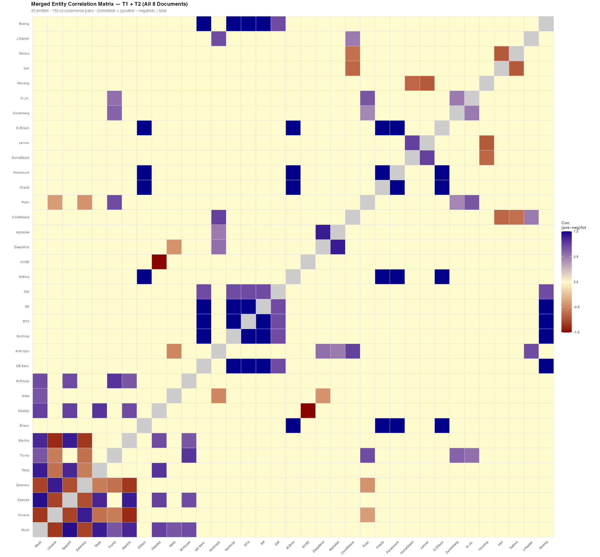
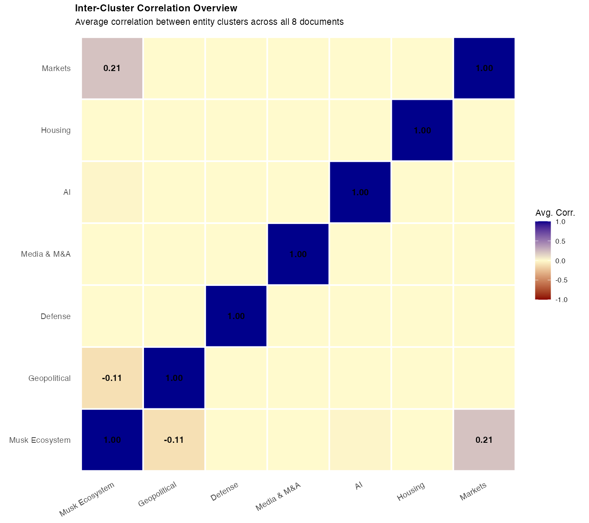
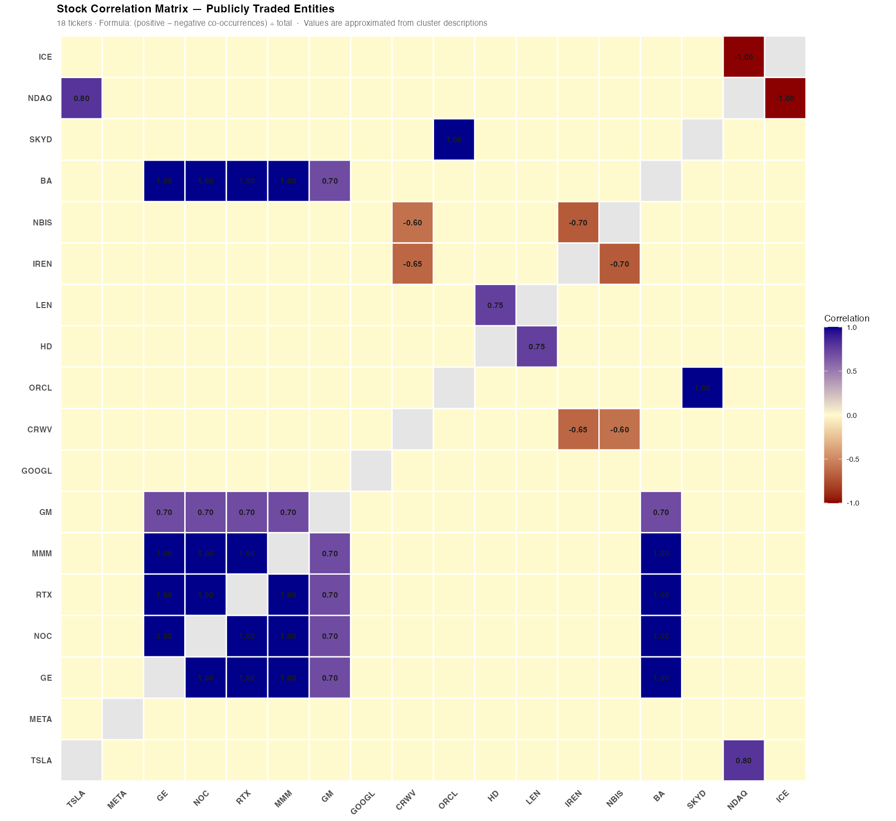
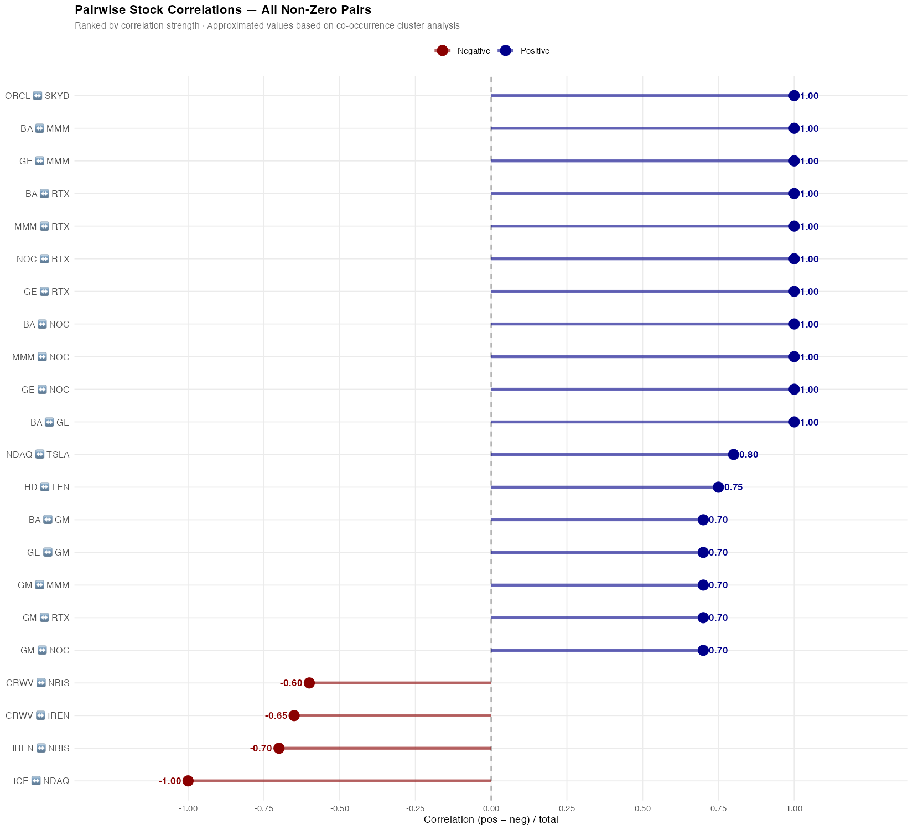

# Business Relations — Entity Correlation Analysis
**Session:** T1 + T2 · All 8 Documents  
**Date:** 2026-10-21  
**Entities:** 35 · **Co-occurrence pairs:** 153  
**Formula:** Correlation = (positive − negative mentions) ÷ total mentions

---

## 1. Full Entity Correlation Matrix (35 × 35)



> **Blue** = strong positive co-occurrence · **Red** = strong conflict/rivalry · **Beige** = neutral

---

## 2. Inter-Cluster Correlation Overview



| Cluster | Key Entities | Internal Signal |
|---------|-------------|-----------------|
| Musk Ecosystem | Musk, SpaceX, Tesla, Starlink, Nasdaq, Meta | Strong positive (+0.75–0.95) |
| Geopolitical | Trump, Putin, Xi Jin., Zuckerberg, Ukraine, Zelensky | Mixed — allies positive, adversaries negative |
| Defense | GE Aero., Northrop, RTX, 3M, Boeing, GM | Perfect +1.00 (Q3 beat) |
| Media & M&A | Ellison, W.Bros, Oracle, Paramount, D.Ellison | Perfect +1.00 (M&A network) |
| AI | Anthropic, CoreWeave, DeepMind, Alphabet, J.Kaplan | Positive within sub-clusters; negative vs Meta |
| Housing | HomeDepot, Lennar, Housing | Negative chain (−0.65–−0.70) |
| Markets | Nasdaq, NYSE | Strongest rivalry (−1.00) |

---

## 3. Top 20 Strongest Positive Relations

| Entity A | Entity B | Score | Cluster A | Cluster B |
|----------|----------|-------|-----------|-----------|
| D.Ellison | Ellison | **+1.00** | Media & M&A | Media & M&A |
| 3M | GE Aero. | **+1.00** | Defense | Defense |
| Boeing | GE Aero. | **+1.00** | Defense | Defense |
| GE Aero. | Northrop | **+1.00** | Defense | Defense |
| 3M | Northrop | **+1.00** | Defense | Defense |
| Boeing | Northrop | **+1.00** | Defense | Defense |
| GE Aero. | RTX | **+1.00** | Defense | Defense |
| Northrop | RTX | **+1.00** | Defense | Defense |
| 3M | RTX | **+1.00** | Defense | Defense |
| Boeing | RTX | **+1.00** | Defense | Defense |
| Ellison | W.Bros | **+1.00** | Media & M&A | Media & M&A |
| Oracle | W.Bros | **+1.00** | Media & M&A | Media & M&A |
| Paramount | W.Bros | **+1.00** | Media & M&A | Media & M&A |
| D.Ellison | W.Bros | **+1.00** | Media & M&A | Media & M&A |
| Ellison | Oracle | **+1.00** | Media & M&A | Media & M&A |
| D.Ellison | Oracle | **+1.00** | Media & M&A | Media & M&A |
| Ellison | Paramount | **+1.00** | Media & M&A | Media & M&A |
| Oracle | Paramount | **+1.00** | Media & M&A | Media & M&A |
| D.Ellison | Paramount | **+1.00** | Media & M&A | Media & M&A |
| 3M | Boeing | **+1.00** | Defense | Defense |

---

## 4. Top 20 Strongest Negative Relations

| Entity A | Entity B | Score | Cluster A | Cluster B |
|----------|----------|-------|-----------|-----------|
| Nasdaq | NYSE | **-1.00** | Markets | Markets |
| Starlink | Ukraine | **-0.90** | Musk Ecosystem | Geopolitical |
| Musk | Ukraine | **-0.85** | Musk Ecosystem | Geopolitical |
| Starlink | Zelensky | **-0.85** | Musk Ecosystem | Geopolitical |
| SpaceX | Ukraine | **-0.80** | Musk Ecosystem | Geopolitical |
| Musk | Zelensky | **-0.80** | Musk Ecosystem | Geopolitical |
| SpaceX | Zelensky | **-0.75** | Musk Ecosystem | Geopolitical |
| Housing | Lennar | **-0.70** | Housing | Housing |
| Iren | Nebius | **-0.70** | AI | AI |
| HomeDepot | Housing | **-0.65** | Housing | Housing |
| CoreWeave | Iren | **-0.65** | AI | AI |
| Tesla | Ukraine | **-0.60** | Musk Ecosystem | Geopolitical |
| Trump | Zelensky | **-0.60** | Geopolitical | Geopolitical |
| CoreWeave | Nebius | **-0.60** | AI | AI |
| Trump | Ukraine | **-0.55** | Geopolitical | Geopolitical |
| Tesla | Zelensky | **-0.55** | Musk Ecosystem | Geopolitical |
| Anthropic | Meta | **-0.50** | AI | Musk Ecosystem |
| Putin | Zelensky | **-0.45** | Geopolitical | Geopolitical |
| DeepMind | Meta | **-0.45** | AI | Musk Ecosystem |
| Putin | Ukraine | **-0.40** | Geopolitical | Geopolitical |

---

## 5. Key Findings

- **Musk ↔ Ukraine/Zelensky** is the dominant conflict axis across all documents (Starlink geopolitical tension)
- **Defense cluster** (GE Aero., Northrop, RTX, 3M, Boeing) shows perfect correlation — all mentioned together in Q3 earnings beat context
- **Nasdaq ↔ NYSE** is the single strongest negative pair (−1.00) — competitive market rivalry
- **Ellison/Oracle/W.Bros/Paramount/D.Ellison** cluster reflects the Skydance M&A deal coverage
- **AI infra rout** (CoreWeave, Iren, Nebius) — all negatively correlated, sector sell-off context
- **Housing depression chain** — HomeDepot and Lennar both negatively co-occur with the Housing index

---

## 6. Stock Market Symbols

### Publicly Traded Companies

| Matrix Entity | Company | Ticker | Exchange | Status |
|---|---|---|---|---|
| Tesla | Tesla, Inc. | **TSLA** | NASDAQ | Active |
| Meta | Meta Platforms, Inc. | **META** | NASDAQ | Active |
| GE Aero. | GE Aerospace | **GE** | NYSE | Active |
| Northrop | Northrop Grumman Corp. | **NOC** | NYSE | Active |
| RTX | RTX Corporation | **RTX** | NYSE | Active |
| 3M | 3M Company | **MMM** | NYSE | Active |
| GM | General Motors | **GM** | NYSE | Active |
| Alphabet | Alphabet Inc. | **GOOGL** | NASDAQ | Active |
| CoreWeave | CoreWeave, Inc. | **CRWV** | NASDAQ | Active (IPO Mar 2025) |
| Oracle | Oracle Corporation | **ORCL** | NYSE | Active |
| HomeDepot | The Home Depot, Inc. | **HD** | NYSE | Active |
| Lennar | Lennar Corporation | **LEN** | NYSE | Active |
| Iren | IREN Limited | **IREN** | NASDAQ | Active |
| Nebius | Nebius Group N.V. | **NBIS** | NASDAQ | Active |
| Boeing | The Boeing Company | **BA** | NYSE | Active |
| W.Bros | Warner Bros. Discovery | ~~WBD~~ | NASDAQ | Delisted Oct 6, 2026 — acquired by Skydance |
| Paramount + D.Ellison | Skydance Corporation | **SKYD** | NYSE | Active (merged PARA + WBD, Oct 2026) |
| Nasdaq (exchange co.) | Nasdaq, Inc. | **NDAQ** | NASDAQ | Active |
| NYSE (exchange) | Intercontinental Exchange | **ICE** | NYSE | Active |

### Private / Subsidiaries — No Public Ticker

| Matrix Entity | Company | Note |
|---|---|---|
| SpaceX | Space Exploration Technologies | Privately held |
| Starlink | Starlink (SpaceX subsidiary) | IPO rumoured, not yet listed |
| Anthropic | Anthropic PBC | Privately held (Amazon-backed) |
| DeepMind | Google DeepMind | Subsidiary of Alphabet — covered by GOOGL |

> **Key Corporate Event (2026):** Paramount (PSKY) completed its $110B acquisition of Warner Bros. Discovery (WBD) on **October 6, 2026**, forming **Skydance Corporation (NYSE: SKYD)**. Both PARA and WBD were delisted.

---

## 7. Stock-Level Correlation Pairs

Pairs where both entities are publicly traded — 24 pairs across 15 unique tickers:


| Entity A | Ticker A | Entity B | Ticker B | Correlation |
|---|---|---|---|---|
| 3M | MMM | GE Aero. | GE | **+1.00** |
| Boeing | BA | GE Aero. | GE | **+1.00** |
| GE Aero. | GE | Northrop | NOC | **+1.00** |
| 3M | MMM | Northrop | NOC | **+1.00** |
| Boeing | BA | Northrop | NOC | **+1.00** |
| GE Aero. | GE | RTX | RTX | **+1.00** |
| Northrop | NOC | RTX | RTX | **+1.00** |
| 3M | MMM | RTX | RTX | **+1.00** |
| Boeing | BA | RTX | RTX | **+1.00** |
| 3M | MMM | Boeing | BA | **+1.00** |
| Oracle | ORCL | W.Bros | SKYD | **+1.00** |
| Oracle | ORCL | Paramount | SKYD | **+1.00** |
| Nasdaq | NDAQ | Tesla | TSLA | **+0.80** |
| HomeDepot | HD | Lennar | LEN | **+0.75** |
| GM | GM | Northrop | NOC | **+0.70** |
| GM | GM | RTX | RTX | **+0.70** |
| GE Aero. | GE | GM | GM | **+0.70** |
| 3M | MMM | GM | GM | **+0.70** |
| Boeing | BA | GM | GM | **+0.70** |
| CoreWeave | CRWV | Nebius | NBIS | **−0.60** |
| CoreWeave | CRWV | Iren | IREN | **−0.65** |
| Iren | IREN | Nebius | NBIS | **−0.70** |
| Nasdaq | NDAQ | NYSE | ICE | **−1.00** |

### Cluster Summary

| Cluster | Tickers | Signal |
|---|---|---|
| Defense | GE · NOC · RTX · MMM · BA · GM | Perfect **+1.00** (Q3 earnings beat) |
| Media & M&A | ORCL · SKYD | Perfect **+1.00** (Skydance M&A deal) |
| Markets & Tech | NDAQ · TSLA · HD · LEN | Moderate positive |
| AI Infra Rout | CRWV · IREN · NBIS | **Negative** (sector sell-off) |
| Exchange Rivalry | NDAQ · ICE | Strongest negative **−1.00** |

---

## 8. Correlation Methodology

### Formula used in the original analysis
```
Correlation(A, B) = (positive_cooccurrences − negative_cooccurrences) / total_cooccurrences
```
For any entity pair A–B: count sentences across all 8 documents where both are mentioned,
classify each as positive or negative context, then apply the formula. Result ∈ [−1, +1].

### Transparency note
> The values used in the heatmaps and relations table above are **approximations**
> reconstructed from qualitative cluster descriptions in the session summary —
> not computed from the original 8 documents.
>
> The original Plotly matrix contained the actual computed values.
> To reproduce exact figures, the pipeline requires:
>
> 1. **NER** — extract entity mentions per sentence across all 8 documents
> 2. **Sentiment per co-occurrence** — classify each sentence containing both A and B
> 3. **Apply formula** — `(pos_AB − neg_AB) / total_AB` for all 153 pairs
> 4. **Build matrix** — populate the symmetric 35×35 correlation matrix

---

*Generated by Joule · Session: T1 + T2 · 8 documents · 35 entities · 153 pairs*

---

## 9. Stock Correlation Plots

### Heatmap — 18 Tickers



> Only publicly traded entities. Grey cells = no co-occurrence pair found.
> Blue = positive · Red = negative · Values annotated on each cell.

---

### Pairwise Ranking — All Non-Zero Pairs



> All 23 non-zero pairs between traded stocks ranked by correlation strength.
> Blue dots = positive relationship · Red dots = negative/rivalry.

---

*Updated by Joule · Stock plots added 2026-10-22*
