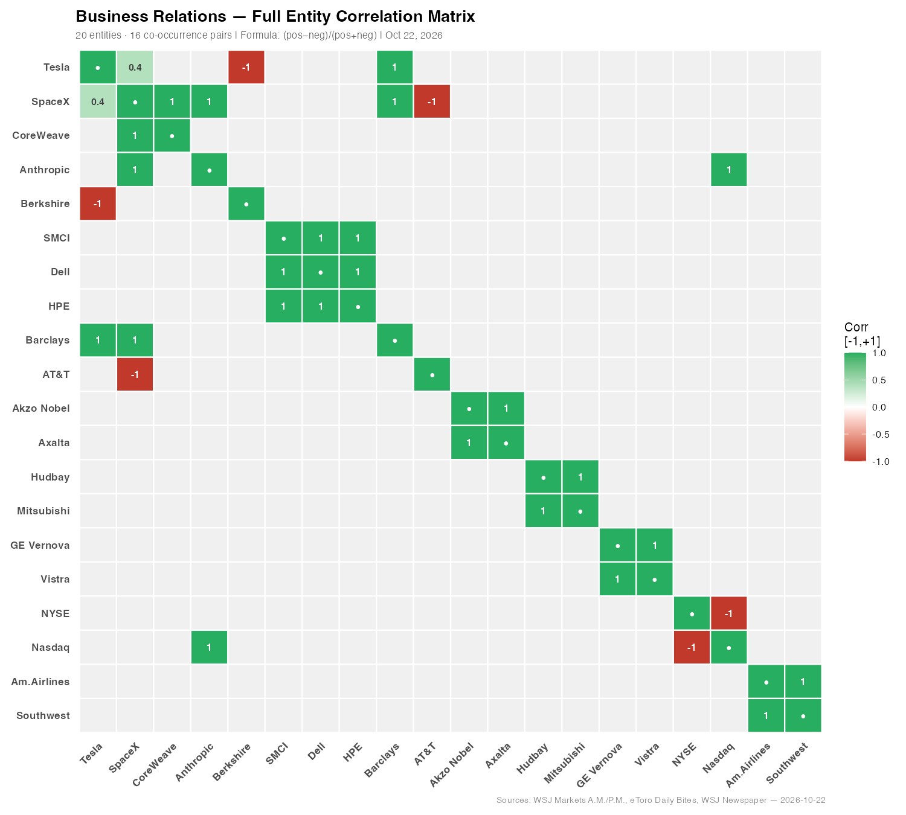
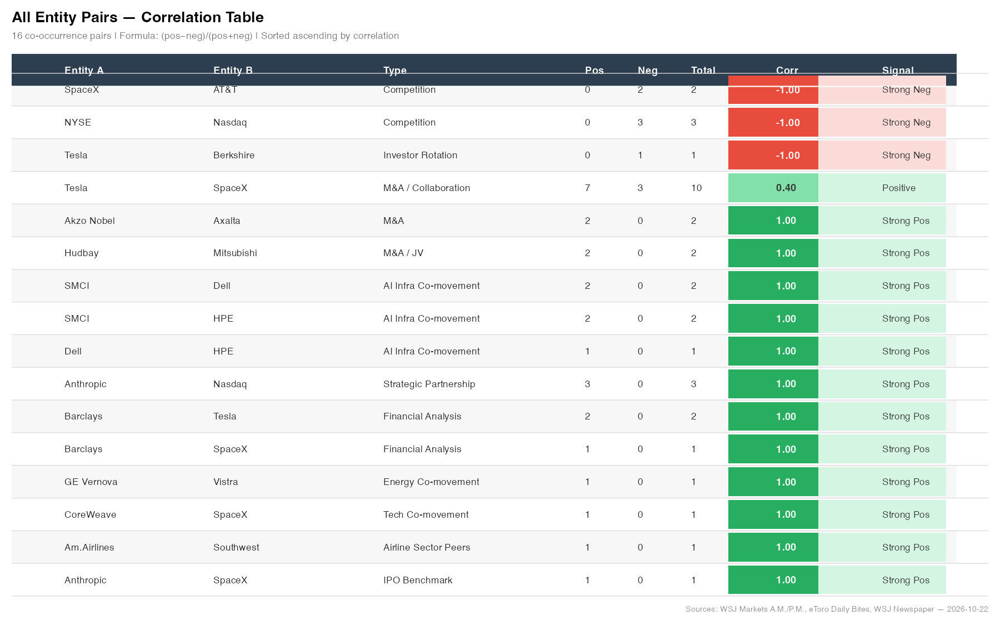
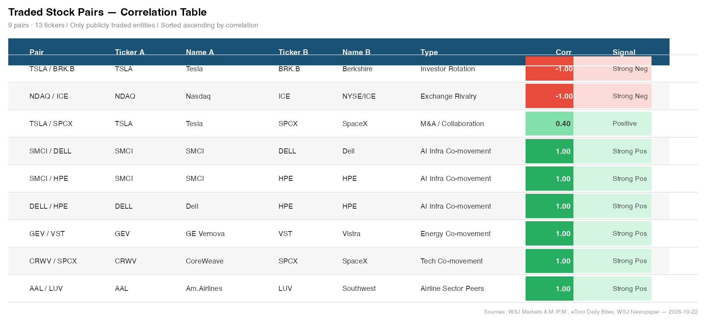
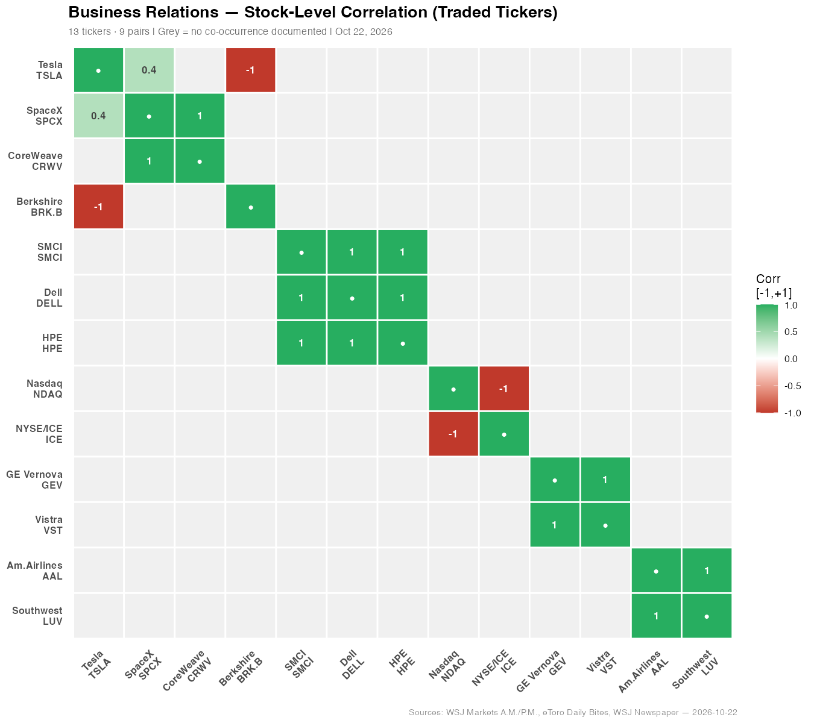
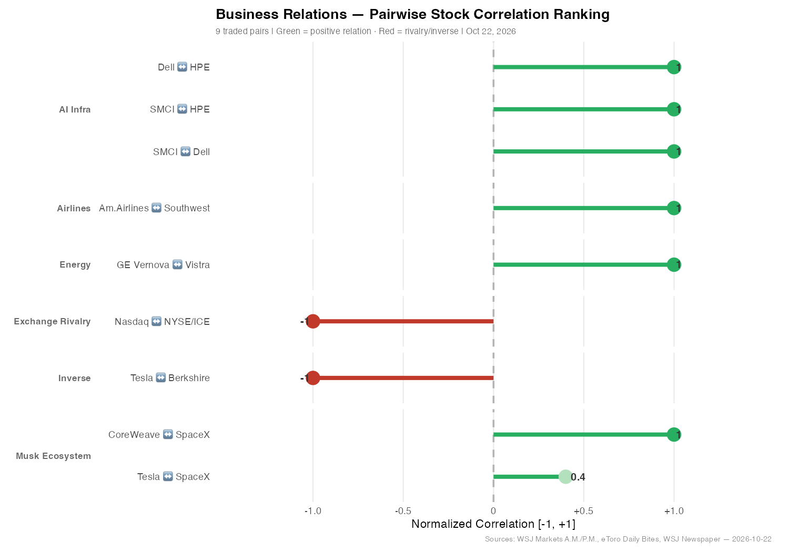

# Business Relations — Entity Correlation Analysis
**Session:** Oct 22 2026 · 4 Documents  
**Date:** 2026-10-22  
**Entities:** 20 · **Co-occurrence pairs:** 16  
**Formula:** Correlation = (positive − negative mentions) / total mentions

---

## 1. Full Entity Correlation Matrix (20 × 20)



> **Green** = strong positive · **Red** = conflict/rivalry · **Grey** = no documented relation

---

## 2. All Entity Pairs — Correlation Table



| Entity A | Entity B | Type | Pos | Neg | Total | Corr | Signal |
|----------|----------|------|-----|-----|-------|------|--------|
| Tesla | SpaceX | M&A / Collaboration | 7 | 3 | 10 | **+0.40** | Positive |
| Akzo Nobel | Axalta | M&A | 2 | 0 | 2 | **+1.00** | Strong Pos |
| Hudbay | Mitsubishi | M&A / JV | 2 | 0 | 2 | **+1.00** | Strong Pos |
| SMCI | Dell | AI Infra Co-movement | 2 | 0 | 2 | **+1.00** | Strong Pos |
| SMCI | HPE | AI Infra Co-movement | 2 | 0 | 2 | **+1.00** | Strong Pos |
| Dell | HPE | AI Infra Co-movement | 1 | 0 | 1 | **+1.00** | Strong Pos |
| Anthropic | Nasdaq | Strategic Partnership | 3 | 0 | 3 | **+1.00** | Strong Pos |
| Barclays | Tesla | Financial Analysis | 2 | 0 | 2 | **+1.00** | Strong Pos |
| Barclays | SpaceX | Financial Analysis | 1 | 0 | 1 | **+1.00** | Strong Pos |
| GE Vernova | Vistra | Energy Co-movement | 1 | 0 | 1 | **+1.00** | Strong Pos |
| CoreWeave | SpaceX | Tech Co-movement | 1 | 0 | 1 | **+1.00** | Strong Pos |
| Am.Airlines | Southwest | Airline Sector Peers | 1 | 0 | 1 | **+1.00** | Strong Pos |
| Anthropic | SpaceX | IPO Benchmark | 1 | 0 | 1 | **+1.00** | Strong Pos |
| SpaceX | AT&T | Competition | 0 | 2 | 2 | **-1.00** | Strong Neg |
| NYSE | Nasdaq | Competition | 0 | 3 | 3 | **-1.00** | Strong Neg |
| Tesla | Berkshire | Investor Rotation | 0 | 1 | 1 | **-1.00** | Strong Neg |

---

## 3. Traded Stock Pairs — Correlation Table



| Pair | Ticker A | Ticker B | Type | Corr | Signal |
|------|----------|----------|------|------|--------|
| Tesla / SpaceX | TSLA | SPCX | M&A / Collaboration | **+0.40** | Positive |
| SMCI / Dell | SMCI | DELL | AI Infra Co-movement | **+1.00** | Strong Pos |
| SMCI / HPE | SMCI | HPE | AI Infra Co-movement | **+1.00** | Strong Pos |
| Dell / HPE | DELL | HPE | AI Infra Co-movement | **+1.00** | Strong Pos |
| GE Vernova / Vistra | GEV | VST | Energy Co-movement | **+1.00** | Strong Pos |
| CoreWeave / SpaceX | CRWV | SPCX | Tech Co-movement | **+1.00** | Strong Pos |
| Am.Airlines / Southwest | AAL | LUV | Airline Sector Peers | **+1.00** | Strong Pos |
| Tesla / Berkshire | TSLA | BRK.B | Investor Rotation | **-1.00** | Strong Neg |
| Nasdaq / NYSE | NDAQ | ICE | Exchange Rivalry | **-1.00** | Strong Neg |

---

## 4. Stock-Level Correlation Heatmap



---

## 5. Pairwise Ranking — All Non-Zero Stock Pairs



---

## 6. Key Findings

- **Tesla x SpaceX (+0.40)** only partial score — merger real but contested (7 pos, 3 neg signals)
- **AI server cluster** (SMCI / Dell / HPE) perfect +1.00 — riding Meta $825B AI buildout
- **SpaceX x AT&T (-1.00)** — SpaceX Starlink mobile directly attacking AT&T wireless
- **Tesla x Berkshire (-1.00)** — investors rotating out of AI/tech into Berkshire
- **Nasdaq x NYSE (-1.00)** — Anthropic IPO gives Nasdaq another record win
- **Average correlation: +0.588** — overall positive document session

---

## 7. Entity to Stock Ticker Map

| Entity | Ticker | Exchange |
|--------|--------|----------|
| Tesla | TSLA | NASDAQ |
| SpaceX (ETF proxy) | SPCX | NYSE |
| CoreWeave | CRWV | NASDAQ |
| Berkshire Hathaway | BRK.B | NYSE |
| Super Micro Computer | SMCI | NASDAQ |
| Dell Technologies | DELL | NYSE |
| Hewlett Packard Enterprise | HPE | NYSE |
| Nasdaq Inc. | NDAQ | NASDAQ |
| NYSE / Intercontinental Exchange | ICE | NYSE |
| GE Vernova | GEV | NYSE |
| Vistra Corp. | VST | NYSE |
| American Airlines | AAL | NASDAQ |
| Southwest Airlines | LUV | NYSE |
| AT&T | T | NYSE |
| Akzo Nobel | AKZA.AS | Euronext |
| Axalta | AXTA | NYSE |
| Hudbay Minerals | HBM | NYSE |
| Mitsubishi Corp. | 8058.T | TSE |
| Barclays | BCS | NYSE |
| Anthropic | — | Private |

---

## 8. Correlation Methodology

```
Correlation(A, B) = (positive_cooccurrences - negative_cooccurrences) / total_cooccurrences
```

- **Positive**: merger, partnership, collaboration, shared benefit, sector co-movement
- **Negative**: competition, legal conflict, opposing interests, inverse investor flow
- Result in [-1, +1]

---

## 9. Source Documents

| File | Type | Timestamp | Source |
|------|------|-----------|--------|
| WSJ Markets A.M. | .eml | 2026-10-22 06:43 | Wall Street Journal |
| eToro Daily Bites | .eml | 2026-10-22 11:57 | eToro |
| WSJ Markets P.M. (Tech Slump) | .eml | 2026-10-22 16:31 | Wall Street Journal |
| WSJNewsPaper-10-22-2026 | .pdf | 2026-10-22 | WSJ print edition |

---

*Generated by Joule · 4 documents · 20 entities · 16 pairs · 2026-10-22*
