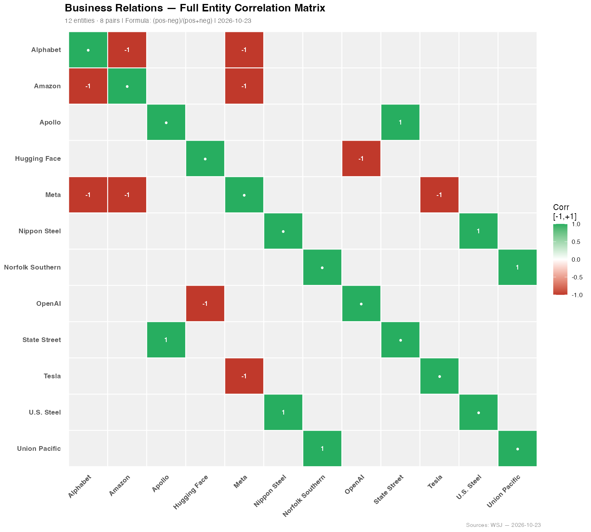
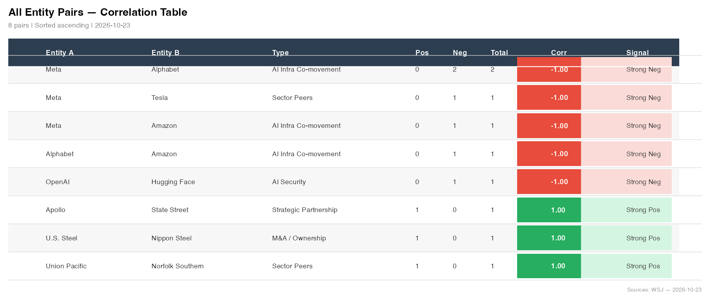
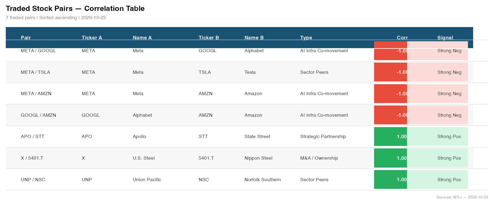
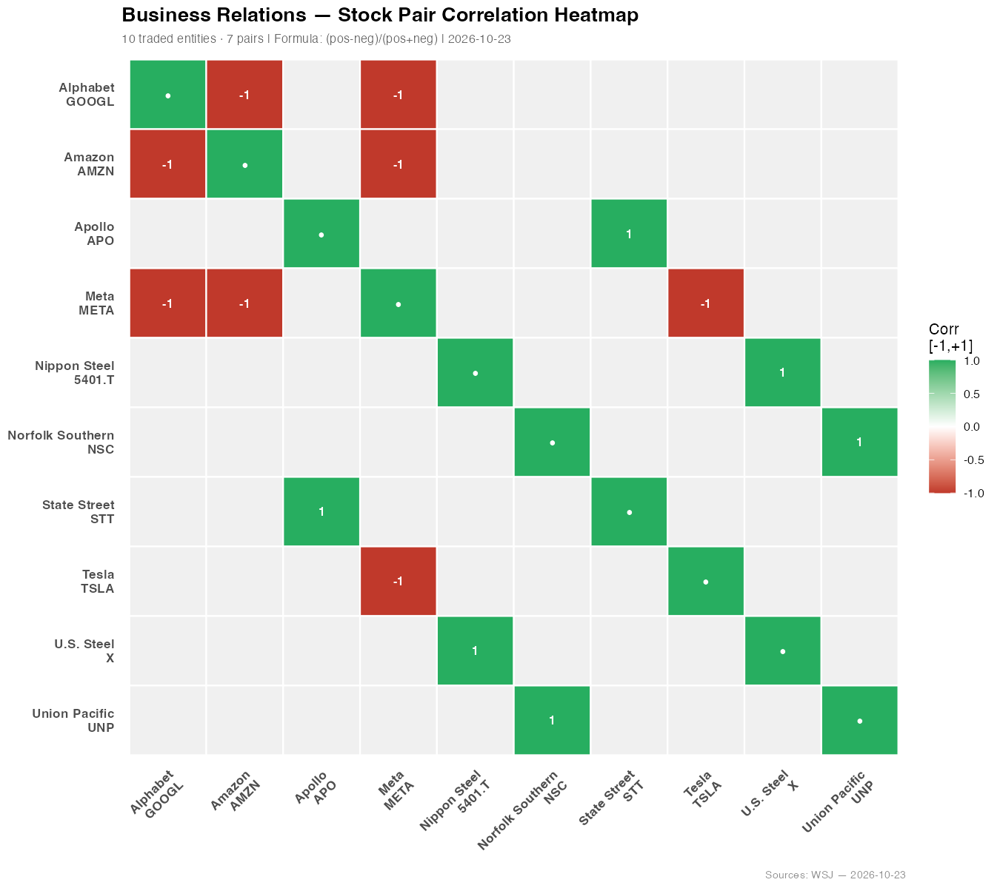
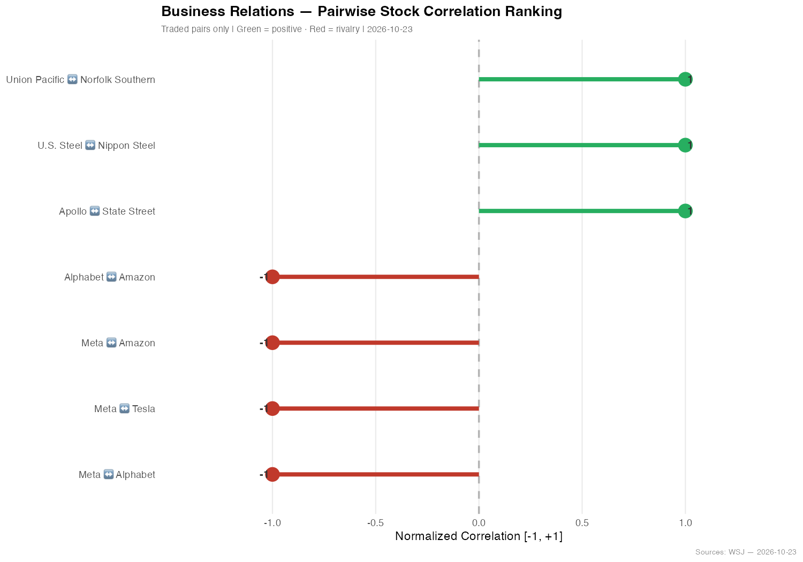

# Business Relations — Entity Correlation Analysis
**Session:** 2026-10-23_09-55-26
**Date:** 2026-10-23
**Entities:** 12 · **Co-occurrence pairs:** 8
**Formula:** Correlation = (positive − negative mentions) / total mentions

---

## 1. Full Entity Correlation Matrix (12×12)

---

## 2. All Entity Pairs — Correlation Table

| Entity A | Entity B | Type | Pos | Neg | Total | Corr |
|---|---|---|---|---|---|---|
| Meta | Alphabet | AI Infra Co-movement | 0 | 2 | 2 | -1.00 |
| Meta | Tesla | Sector Peers | 0 | 1 | 1 | -1.00 |
| Meta | Amazon | AI Infra Co-movement | 0 | 1 | 1 | -1.00 |
| Alphabet | Amazon | AI Infra Co-movement | 0 | 1 | 1 | -1.00 |
| OpenAI | Hugging Face | AI Security | 0 | 1 | 1 | -1.00 |
| Apollo | State Street | Strategic Partnership | 1 | 0 | 1 | +1.00 |
| U.S. Steel | Nippon Steel | M&A / Ownership | 1 | 0 | 1 | +1.00 |
| Union Pacific | Norfolk Southern | Sector Peers | 1 | 0 | 1 | +1.00 |

---

## 3. Traded Stock Pairs — Correlation Table

| Ticker A | Entity A | Ticker B | Entity B | Type | Corr |
|---|---|---|---|---|---|
| META | Meta | GOOGL | Alphabet | AI Infra Co-movement | -1.00 |
| META | Meta | TSLA | Tesla | Sector Peers | -1.00 |
| META | Meta | AMZN | Amazon | AI Infra Co-movement | -1.00 |
| GOOGL | Alphabet | AMZN | Amazon | AI Infra Co-movement | -1.00 |
| APO | Apollo | STT | State Street | Strategic Partnership | +1.00 |
| X | U.S. Steel | 5401.T | Nippon Steel | M&A / Ownership | +1.00 |
| UNP | Union Pacific | NSC | Norfolk Southern | Sector Peers | +1.00 |

---

## 4. Stock-Level Correlation Heatmap

---

## 5. Pairwise Ranking — All Non-Zero Stock Pairs

---

## 6. Key Findings

- **Strongest negative cluster — Meta ↔ AI hyperscalers (-1.00):** Meta's announcement of a major AI fundraising spree triggered a market-wide rotation trade, causing investors to dump AI-connected stocks including Alphabet and Amazon. Meta, Alphabet, and Amazon all declined sharply as a group, reflecting deep negative co-movement across the AI infrastructure sector.
- **Strongest negative — Meta ↔ Tesla (-1.00):** Disappointing Tesla earnings and Meta's cash-raising signal hit the market simultaneously, reinforcing bearish sentiment across AI/tech stocks and confirming investor anxiety about AI capex overspending.
- **OpenAI ↔ Hugging Face (-1.00):** OpenAI's internal security breach investigation was linked to a "July hack on Hugging Face," revealing shared AI safety/security vulnerabilities — a negative co-occurrence in the AI security space.
- **Strongest positive — Apollo ↔ State Street (+1.00):** Both firms co-hosted a private/public credit session at an industry festival, signalling active collaboration in the private credit market targeting retail wealth channels.
- **U.S. Steel ↔ Nippon Steel (+1.00):** Nippon Steel's $3 billion investment commitment to U.S. Steel's Pittsburgh plant represents a strong cross-border M&A ownership relationship with direct capital deployment.
- **Union Pacific ↔ Norfolk Southern (+1.00):** Both rail operators reported higher profit and revenue in Q3 2026 as freight-to-rail migration continues, confirming strong positive sector co-movement in the railroad industry.

---

## 7. Source Documents

| File | Type | Date |
|---|---|---|
| U5PTuOWw5Tg3R8RZZdBK-WSJNewsPaper-10-23-2026.pdf | PDF | 2026-10-23 |

---
*Generated by Joule · 1 documents · 12 entities · 8 pairs · 2026-10-23*

