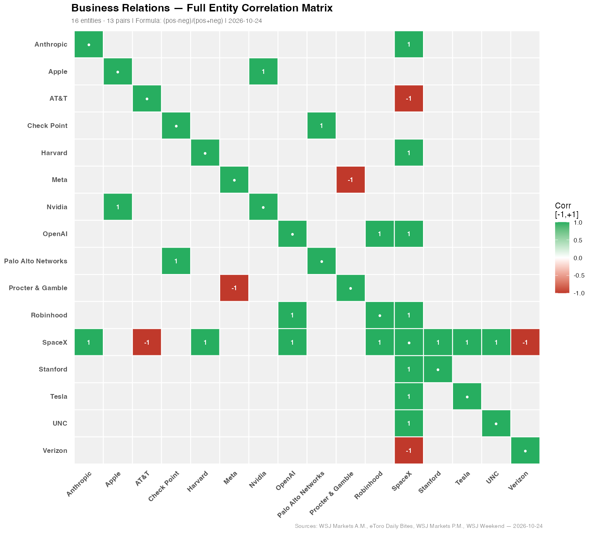
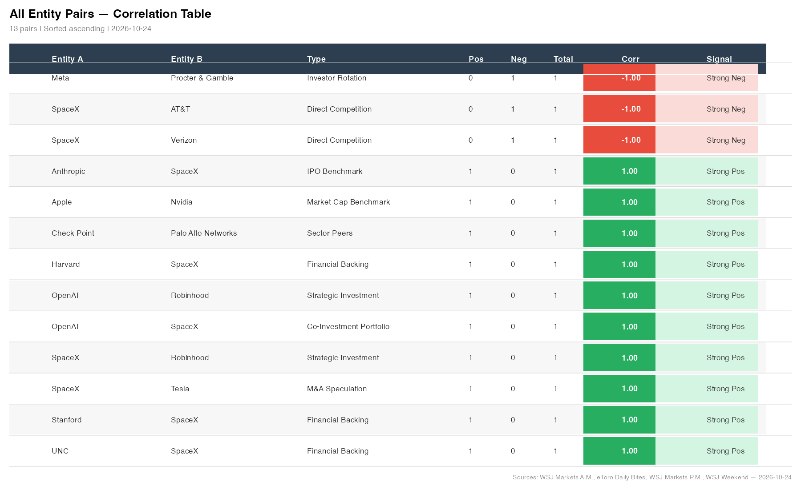
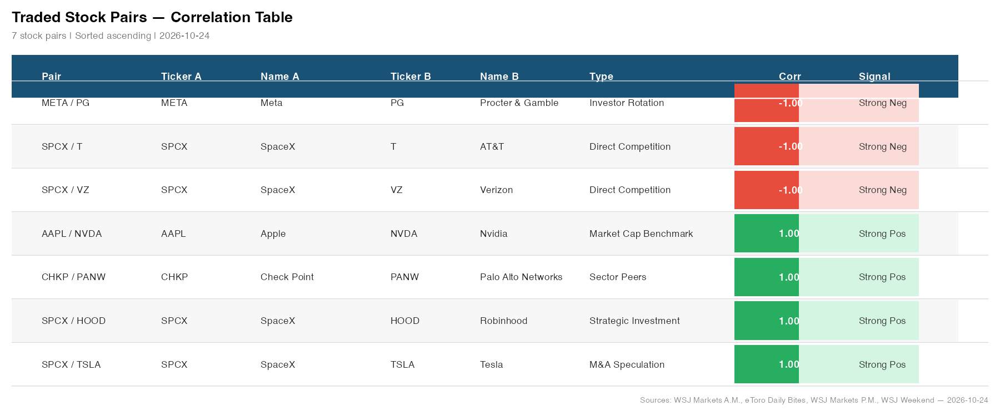
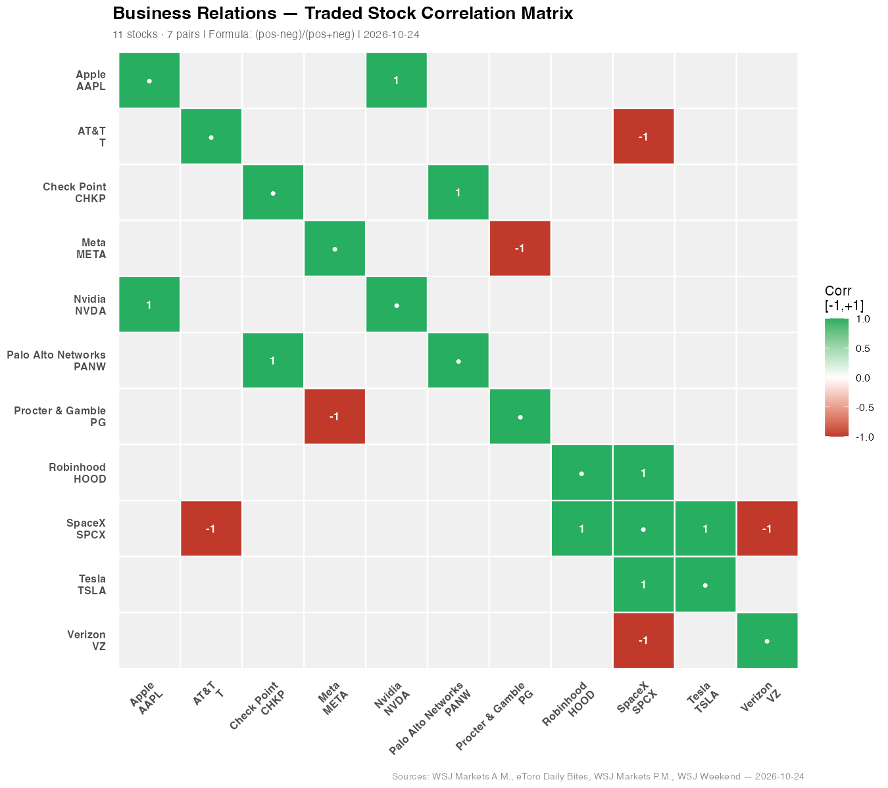
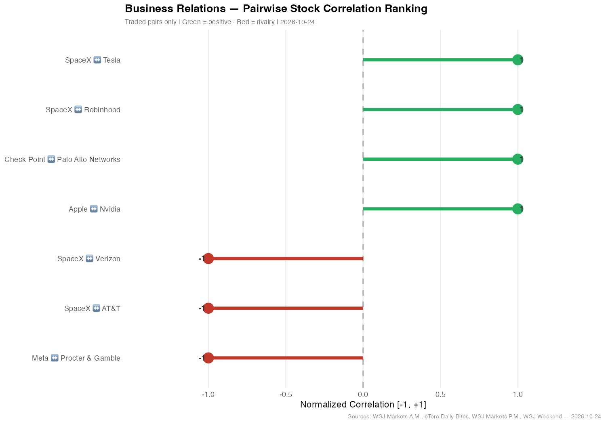

# Business Relations — Entity Correlation Analysis
**Session:** 2026-10-24_11-40-49
**Date:** 2026-10-24
**Entities:** 16 · **Co-occurrence pairs:** 13
**Formula:** Correlation = (positive − negative mentions) / total mentions

---

## 1. Full Entity Correlation Matrix (16×16)

---

## 2. All Entity Pairs — Correlation Table

| Entity A | Entity B | Type | Pos | Neg | Total | Corr |
|---|---|---|---|---|---|---|
| Meta | Procter & Gamble | Investor Rotation | 0 | 1 | 1 | -1.00 |
| SpaceX | AT&T | Direct Competition | 0 | 1 | 1 | -1.00 |
| SpaceX | Verizon | Direct Competition | 0 | 1 | 1 | -1.00 |
| Anthropic | SpaceX | IPO Benchmark | 1 | 0 | 1 | +1.00 |
| Apple | Nvidia | Market Cap Benchmark | 1 | 0 | 1 | +1.00 |
| Check Point | Palo Alto Networks | Sector Peers | 1 | 0 | 1 | +1.00 |
| Harvard | SpaceX | Financial Backing | 1 | 0 | 1 | +1.00 |
| OpenAI | Robinhood | Strategic Investment | 1 | 0 | 1 | +1.00 |
| OpenAI | SpaceX | Co-Investment Portfolio | 1 | 0 | 1 | +1.00 |
| SpaceX | Robinhood | Strategic Investment | 1 | 0 | 1 | +1.00 |
| SpaceX | Tesla | M&A Speculation | 1 | 0 | 1 | +1.00 |
| Stanford | SpaceX | Financial Backing | 1 | 0 | 1 | +1.00 |
| UNC | SpaceX | Financial Backing | 1 | 0 | 1 | +1.00 |

---

## 3. Traded Stock Pairs — Correlation Table

| Entity A | Entity B | Ticker A | Ticker B | Type | Pos | Neg | Total | Corr |
|---|---|---|---|---|---|---|---|---|
| Meta | Procter & Gamble | META | PG | Investor Rotation | 0 | 1 | 1 | -1.00 |
| SpaceX | AT&T | SPCX | T | Direct Competition | 0 | 1 | 1 | -1.00 |
| SpaceX | Verizon | SPCX | VZ | Direct Competition | 0 | 1 | 1 | -1.00 |
| Apple | Nvidia | AAPL | NVDA | Market Cap Benchmark | 1 | 0 | 1 | +1.00 |
| Check Point | Palo Alto Networks | CHKP | PANW | Sector Peers | 1 | 0 | 1 | +1.00 |
| SpaceX | Robinhood | SPCX | HOOD | Strategic Investment | 1 | 0 | 1 | +1.00 |
| SpaceX | Tesla | SPCX | TSLA | M&A Speculation | 1 | 0 | 1 | +1.00 |

---

## 4. Stock-Level Correlation Heatmap

---

## 5. Pairwise Ranking — All Non-Zero Stock Pairs

---

## 6. Key Findings

- **SpaceX is the most central entity** — it appears in 9 of 13 pairs, acting as both a competitive disruptor (vs AT&T, Verizon) and a positive magnet for universities and investment funds (Harvard, Stanford, UNC, Robinhood, OpenAI, Anthropic).
- **Strongest negative pair: SpaceX ↔ AT&T & Verizon (−1.00, Direct Competition)** — SpaceX's plan to build a wireless carrier with 80,000 cell sites sent telecom majors down 3%+ premarket; a zero-sum rivalry is explicit.
- **Meta ↔ Procter & Gamble (−1.00, Investor Rotation)** — The AI-spending hangover triggered a textbook defensive rotation: Meta −7%, P&G +5.6% on the same session — mirror-image investor behaviour.
- **Anthropic ↔ SpaceX (+1.00, IPO Benchmark)** — Anthropic's imminent IPO is framed as the next landmark after SpaceX's record $75B debut, linking both as sequential AI/tech market milestones.
- **Check Point ↔ Palo Alto Networks (+1.00, Sector Peers)** — Cybersecurity names were the only tech sub-sector to rally (+6% / +2.2%) as the rest of tech sold off, benefiting simultaneously from news of a major internet security flaw.

---

## 7. Source Documents

| File | Type | Date |
|---|---|---|
| 🎓 Markets A.M.: Elite Colleges Can Give You an Investing Lesson.eml | Email — WSJ Markets A.M. | 2026-10-23 |
| 🤕 La gueule de bois de l'IA.eml | Email — eToro Daily Bites | 2026-10-23 |
| Market on Edge.eml | Email — WSJ Markets P.M. | 2026-10-23 |
| VJnzbTujuXuhx5ob6dm3-WSJNewsPaper-10-24-2026.pdf | PDF — WSJ Weekend | 2026-10-24 |

---
*Generated by Joule · 4 documents · 16 entities · 13 pairs · 2026-10-24*

